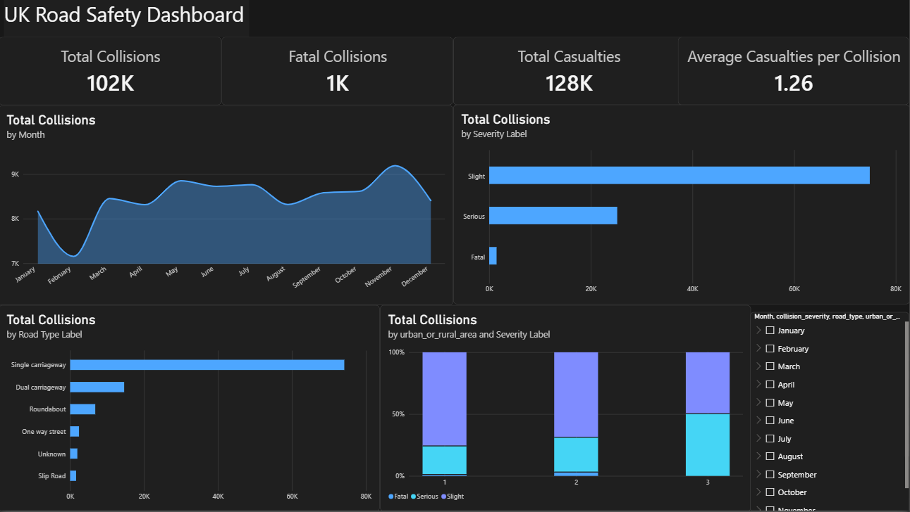

# STATS19 Road Collision Dashboard (2025)

## Overview
Summary and documentation for the **UK Road Safety Dashboard** based on **STATS19** data (**102K** total collisions, **1K** fatal collisions, **128K** total casualties, and **1.26** average casualties per collision shown on the main view).

## Key Insights
1. **Monthly Accident Volume:** Are there months with a higher number of accidents than others?
   - *Summary:* Collisions are lowest in **February** (~7.2K) and highest in **November** (just above 9K), with a secondary plateau around ~8.7K–8.8K between May and July.
2. **Distribution by Severity:** How are accidents distributed by severity level?
   - *Summary:* **Slight** (~75K) dominates, followed by **Serious** (~25K) and **Fatal** (~1K).
3. **Most Affected Road Type:** Which road type has the highest number of recorded accidents?
   - *Summary:* **Single carriageway** has the highest volume (~75K), ahead of **Dual carriageway** (~14K) and **Roundabout** (~7K).
4. **Urban vs. Rural Severity Proportions:** Do severity category proportions differ between urban and rural areas?
   - *Summary:* Across area codes `1`, `2`, and `3`, Serious shares rise from ~24% (code `1`) to ~29% (code `2`) and ~50% (code `3`), while Slight shares decrease from ~75% to ~68% and ~50%. Verify how codes `1`, `2`, and `3` map to urban/rural labels.
5. **Lighting & Weather Patterns:** Do lighting or weather conditions show notable patterns?
   - *Summary:* `[Pending screenshot/visual for lighting and weather conditions]`

## Limitations & Caveats
- The dataset covers **Great Britain**, not Indonesia.
- The dataset only includes accidents resulting in injury that were reported to the police and recorded in the **STATS19** system, rather than all traffic incidents.
- Data is sourced via **GOV.UK**.
- Raw accident counts are not a direct measure of risk; evaluating risk requires denominators such as traffic volume, distance travelled, or number of vehicles.
- A single year of data is not sufficient to establish long-term trends.
- Associations between weather, road type, and severity do not establish causation.
- Severity counts should be read in light of the **Department for Transport (DfT)** severity adjustment methodology.

## Attribution
Contains public sector information licensed under the Open Government Licence v3.0. Source: Department for Transport, Road Safety Open Data, STATS19, 2025.
